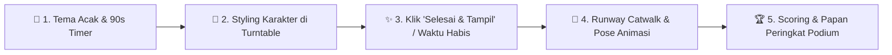

# Technical Specification: "Glamour Runway 3D" – Web-Based Fashion Game

**Document Version:** 1.0.0  
**Author:** Lead Architect & Product Manager (@pm)  
**Status:** Pending User Approval  
**Date:** November 20, 2026  
**Artifact Path:** `production_artifacts/Technical_Specification.md`  

---

## 1. Ringkasan Eksekutif (Executive Summary)

**"Glamour Runway 3D"** adalah prototipe game fashion 3D berbasis web yang terinspirasi dari gameplay viral bergaya *"Dress to Impress"*. Game ini dirancang menggunakan web stack modern dengan **Three.js** untuk rendering 3D grafis real-time, HTML5/CSS3 untuk antarmuka pengguna (UI) modern dan estetik, serta Vanilla JavaScript modular.

Game ini mengimplementasikan siklus permainan lengkap (Core Game Loop):
1. **Fase Persiapan & Kustomisasi (Dressing Room)**: Pemain mendapatkan tema acak, timer hitung mundur 90 detik, panggung turntable yang bisa diputar 360°, dan panel kustomisasi 3D real-time (rambut, pakaian, bawahan, sepatu, aksesoris, dan palet warna interaktif).
2. **Fase Runway & Catwalk**: Kamera beralih sinematik ke sudut pandang panggung catwalk. Karakter berjalan maju menuju ujung panggung (catwalk runway), melakukan pose modeling dramatis diiringi efek kilatan kamera blitz dan partikel gemerlap.
3. **Fase Penjurian & Peringkat (Scoring & Podium)**: Sistem evaluasi otomatis berdasarkan kecocokan tema dan harmoni warna, rating bintang (1–5 bintang), serta papan peringkat podium (Juara 1, 2, dan 3) bersaing melawan 3 kontestan AI yang memiliki outfit tematik unik.

---

## 2. Arsitektur Teknis & Tech Stack

### 2.1 Pilihan Teknologi
| Komponen | Teknologi | Alasan Pemilihan |
| :--- | :--- | :--- |
| **3D Engine** | **Three.js (r128+)** | Standar industri rendering 3D di browser via WebGL. Ringan, performa tinggi 60 FPS, dan didukung OrbitControls untuk rotasi interaktif. |
| **Model & Aset 3D** | **Procedural 3D Mesh & Material Generator** | Seluruh karakter chibi/stylized, pakaian, rambut, dan aksesoris dibuat menggunakan geometri prosedural Three.js (Lathe, Cylinder, Extrude, Torus, Sphere). Hal ini menjamin **100% zero-dependency terhadap file eksternal 3D (.gltf/.obj)**, bebas error CORS/404, dan rendering instan! |
| **Frontend UI/UX** | **HTML5 + CSS3 (Modern Glassmorphism & Cyber/Fashion Pastel)** | Tampilan bersih, responsif, elegan, font modern, dan transisi halus tanpa overhead framework berat. |
| **Audio & SFX** | **Web Audio API Synth** | Efek suara sintetis (klik tombol, camera flash, countdown tick, runway synth beats, fanfare tepuk tangan) langsung dari browser tanpa file audio eksternal. |
| **Backend & Server** | **Node.js + Express** | Server lokal sederhana untuk menyajikan file statis dan API endpoint health check secara cepat via `npm install && npm start`. |

---

## 3. Spesifikasi Fitur & Gameplay

### 3.1 Scene 3D & Pencahayaan Panggung
- **Panggung Bundar (Turntable)**: Panggung silinder berpendar dengan efek reflective floor dan ring light neon di sekelilingnya. Karakter mannequin berada di pusat panggung.
- **Interaksi Kamera**:
  - *Dressing Mode*: Pemain dapat memutar turntable/karakter 360° secara halus menggunakan klik dan drag mouse (atau sentuhan layar).
  - *Zoom & Pan Controls*: Kontrol otomatis yang menjaga fokus kamera pada outfit karakter.
- **Pencahayaan Estetik**:
  - **Main Spotlight**: Cahaya panggung terfokus dari atas-depan dengan bayangan halus (*soft shadows*).
  - **Rim / Fill Light**: Lampu aksen dari belakang dan samping dengan warna kontras lembut (pastel pink / cyan / gold) untuk menonjolkan siluet chibi.
  - **Ambient Light**: Pencahayaan merata agar setiap detail pakaian terlihat jelas.
- **Latar Ruang Ganti**: Dekorasi panggung butik mewah, tirai beludru, cermin berbingkai neon, dan partikel debu gemerlap (dust sparkles).

### 3.2 Sistem Karakter & Kustomisasi 3D Real-Time
- **Karakter Base**: Mannequin 3D stylized/chibi yang proporsional dan menggemaskan (kepala proporsional, badan ramping, tangan dan kaki modular).
- **Slot Kustomisasi Modular**:
  1. **Rambut (Hair)**: 4 pilihan model (e.g., Bob Cut, Twin Tails/Pigtails, Long Wavy, Sleek Ponytail).
  2. **Atasan/Gaun (Tops/Dresses)**: 5 pilihan model (e.g., Crop Top, Off-Shoulder Ballgown, Chic Blazer, Halter Vest, Hoodie).
  3. **Bawahan (Bottoms)**: 5 pilihan model (e.g., Pleated Tennis Skirt, Flare Jeans, High-Waist Shorts, Mermaid Skirt, Cyber Pants).
  4. **Sepatu (Shoes)**: 4 pilihan model (e.g., Platform Sneakers, High Heels, Combat Boots, Strappy Sandals).
  5. **Aksesoris Kepala (Headwear/Accessories)**: 4 pilihan model (e.g., Cat Ear Headband, Royal Tiara, Beret Hat, Cyberpunk Visor, Halo).
- **Penggantian Real-Time**: Ketika pemain mengklik item di panel UI, mesh pada slot tersebut langsung diganti secara instan tanpa glitch.
- **Color Palette & Color Picker**:
  - Palet preset warna estetik (Pastel Pink, Cyber Violet, Emerald Green, Pure White, Midnight Black, Metallic Gold, Coral Peach, Crimson Red).
  - Custom Color Wheel (HTML5 color picker) yang mengubah material `color` dan `specular` pakaian yang sedang aktif secara real-time.

### 3.3 Core Gameplay Loop



#### A. Tema Acak & Timer 90 Detik
- Sistem mengundi tema acak di awal ronde dari daftar tema fashion:
  - *Cyberpunk Gala* (Futuristic, Metallic, Neon)
  - *Royal Elegance* (Gold, Dresses, Tiara, Luxury)
  - *Y2K Pop Star* (Pink, Crop Tops, Playful, Accessories)
  - *Gothic Romance* (Black, Crimson, Chokers, Boots)
  - *Summer Beach Party* (Pastel, Shorts, Sandals, Casual)
  - *Cottagecore Dream* (Earth tones, Flowy skirts, Soft hair)
- Timer 90 detik berjalan mundur dengan visual bar progresif.
- Tombol **"Selesai & Tampil"** memungkinkan pemain langsung melompat ke runway jika sudah puas dengan tampilannya sebelum waktu habis.

#### B. Fase Runway Catwalk & Pose Animasi
- Kamera beralih mulus (*cinematic transition*) dari sudut fitting room ke sudut panjang panggung catwalk.
- Karakter berjalan maju menuju ujung catwalk dengan animasi walk cycle prosedural (ayunan kaki, tangan, dan pantulan tubuh).
- Begitu sampai di ujung panggung:
  - Karakter melakukan serangkaian pose modeling (e.g., Pose Pinggang, Pose Model V, Pose Kiss/Wink).
  - Efek kilatan blitz kamera (paparazzi flash screen effect) menyala berulang kali.
  - Partikel kembang api/sparkles bermunculan di sekeliling model.

#### C. Sistem Penjurian & Peringkat
- **Evaluasi Otomatis**:
  - Skor Kecocokan Tema (*Theme Affinity*): Setiap item pakaian memiliki tag gaya (e.g., `royal`, `cyber`, `vintage`, `casual`). Skor dihitung berdasarkan persentase kecocokan tag dengan tema aktif.
  - Skor Kelengkapan Outfit: Bonus jika pemain melengkapi semua slot (rambut, atasan, bawahan, sepatu, aksesoris).
  - Skor Harmoni Warna: Algoritma mengevaluasi kontras dan kohesi warna material.
- **Kompetisi Melawan 3 AI Model**:
  - AI 1, AI 2, dan AI 3 dibuat secara dinamis dengan kombinasi outfit dan warna berbeda.
  - Skor akhir dikonversi ke **Rating Bintang (1 hingga 5 Bintang)** dan nilai total (0–100 poin).
- **Layar Podium**:
  - Menampilkan tangga juara ke-1, ke-2, dan ke-3 dengan model 3D masing-masing pemenang berpose di podium.
  - Tombol **"Main Lagi (Play Again)"** untuk mengulang permainan dengan tema baru.

---

## 4. Struktur Folder & Modul Proyek (`app_build/`)

Semua kode akan disimpan di dalam direktori `app_build/` dengan struktur modular:

```
app_build/
├── package.json              # Konfigurasi project & dependensi Express
├── server.js                 # Express web server lokal untuk hosting game
├── public/
│   ├── index.html            # Markup utama UI, Canvas 3D, modal dialog & HUD
│   ├── css/
│   │   └── style.css         # Styling modern glassmorphism, responsive UI, animasi
│   ├── js/
│   │   ├── main.js           # Entry point inisialisasi game loop & state manager
│   │   ├── scene.js          # Three.js setup (Scene, Camera, Renderer, Lighting, Turntable)
│   │   ├── character.js      # Procedural 3D Character Mannequin & Slot Attachment Manager
│   │   ├── items.js          # Definisi katalog 3D mesh (Hair, Tops, Bottoms, Shoes, Accessories)
│   │   ├── runway.js         # Logika Catwalk, animasi walk cycle, camera track & pose
│   │   ├── gameManager.js    # State machine game, tema acak, timer 90s, skor & AI bots
│   │   └── audio.js          # Web Audio API Sound FX generator (flash, clicks, applause)
└── README.md                 # Petunjuk instalasi dan cara menjalankan game
```

---

## 5. Kriteria Penerimaan (Acceptance Criteria)

1. **Jalankan Natively**: Server dapat dijalankan dengan perintah standar `npm install && npm start` pada `http://localhost:3000`.
2. **Scene 3D & Orbit**: Mannequin chibi 3D berdiri di turntable yang dapat diputar bebas 360° menggunakan mouse drag.
3. **Kustomisasi Real-Time**: UI overlay di samping layar dapat mengganti Rambut, Atasan, Bawahan, Sepatu, dan Aksesoris kepala seketika.
4. **Palet Warna Responsif**: Mengubah warna material pakaian yang dipilih secara langsung pada model 3D.
5. **Gameplay Timer & Tema**: Menampilkan tema acak di header, countdown timer 90 detik, dan tombol "Selesai & Tampil".
6. **Animasi Catwalk**: Transisi sinematik, karakter berjalan di catwalk, pose modeling, dan blitz kamera.
7. **Sistem Skor & Peringkat**: Penjurian otomatis dengan rating bintang dan leaderboard 1–3 bersama 3 AI model.
8. **Konsol Bersih**: Kode modular, terstruktur rapi, dan bebas error di console browser.

---

## 6. Persetujuan Spesifikasi (Approval Gate)

Sebagai **Product Manager (@pm)**, spesifikasi teknis lengkap telah saya susun dan simpan di:  
[Technical_Specification.md](file:///c:/Users/USER/al drey/production_artifacts/Technical_Specification.md)

Mohon periksa spesifikasi dan arsitektur di atas.
